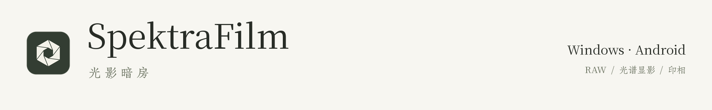
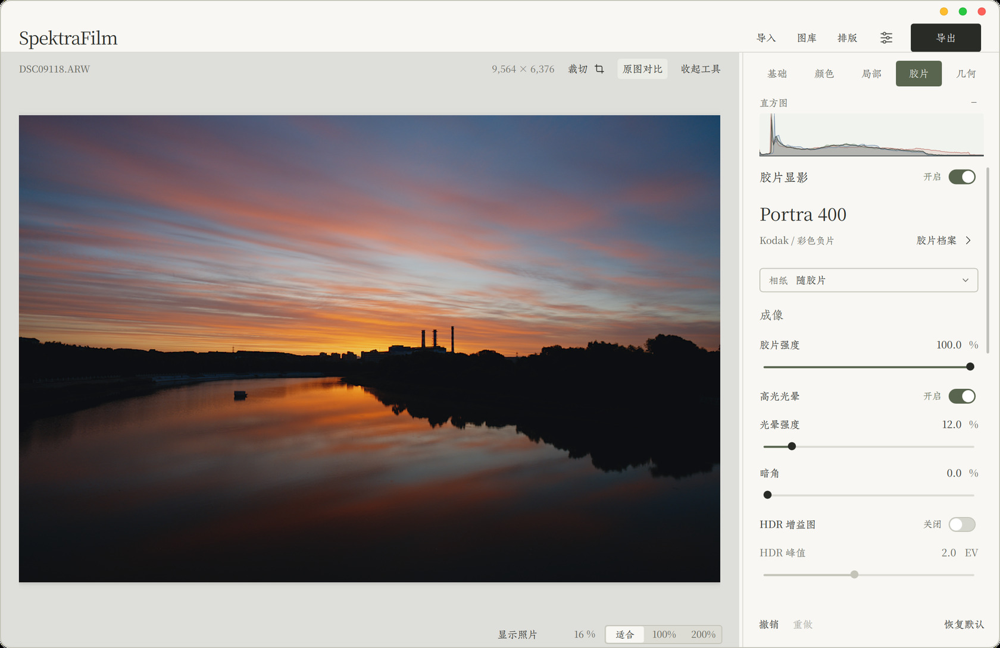
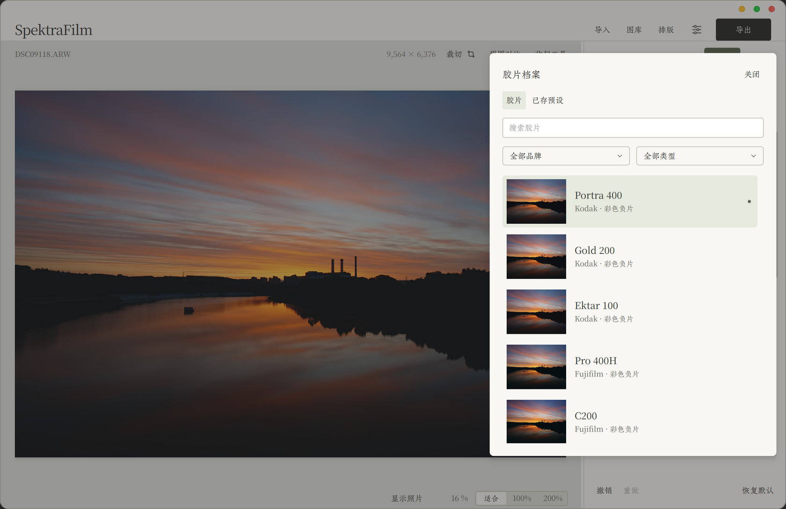
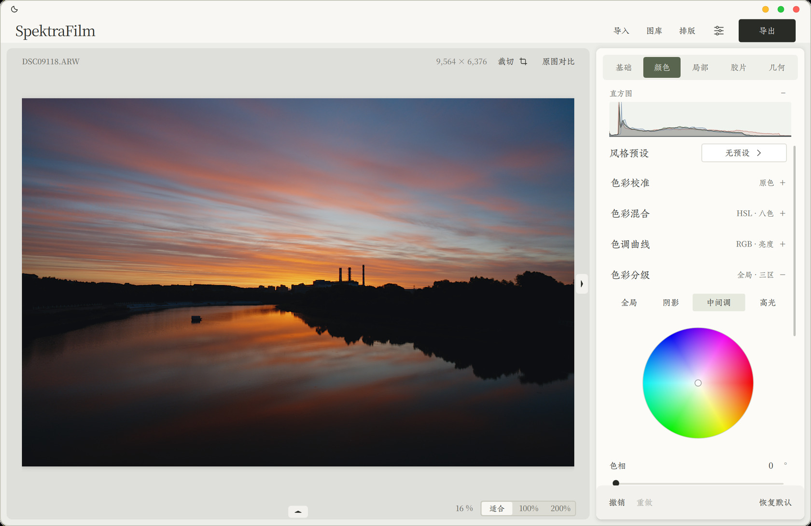
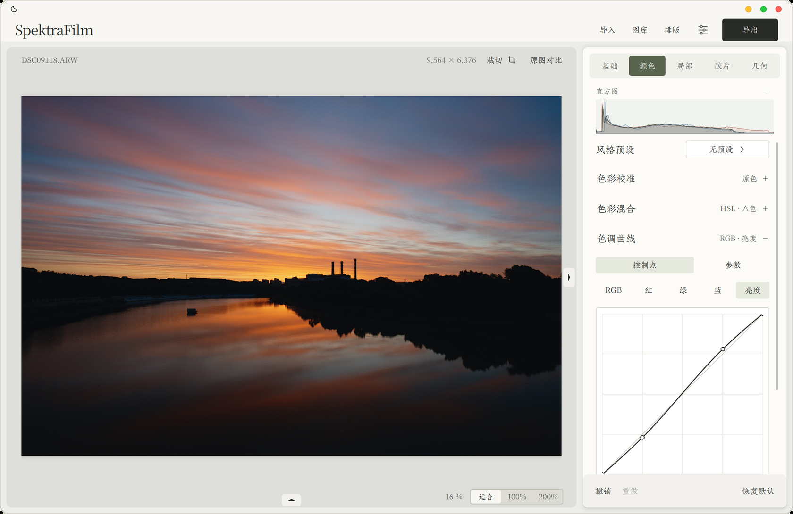
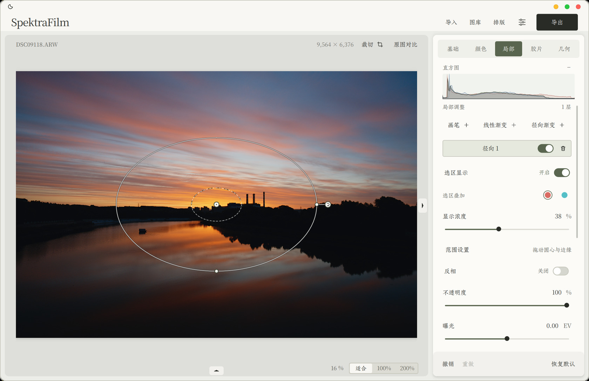
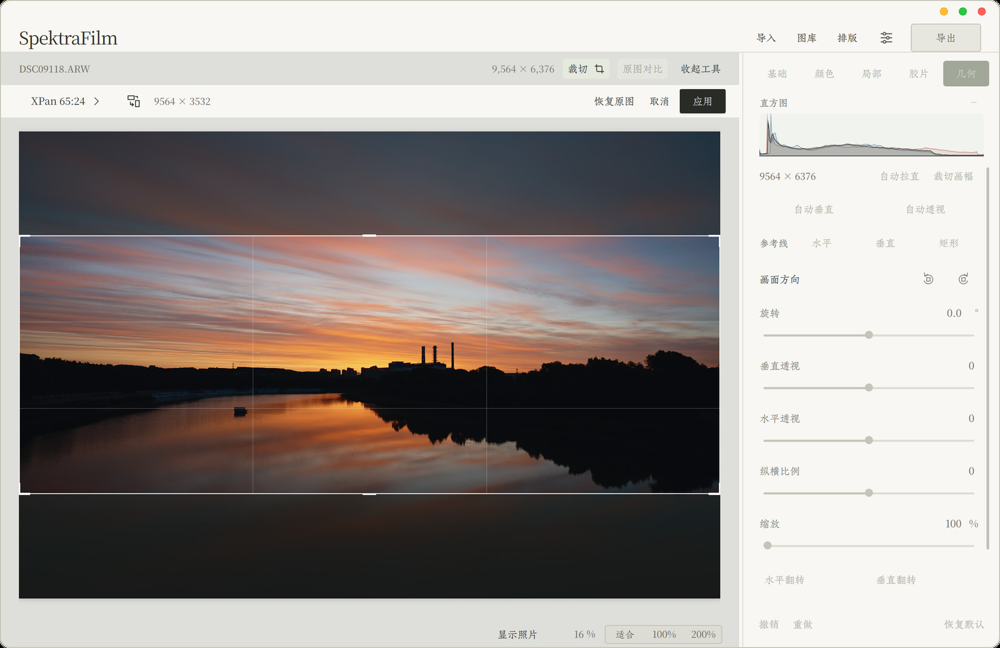
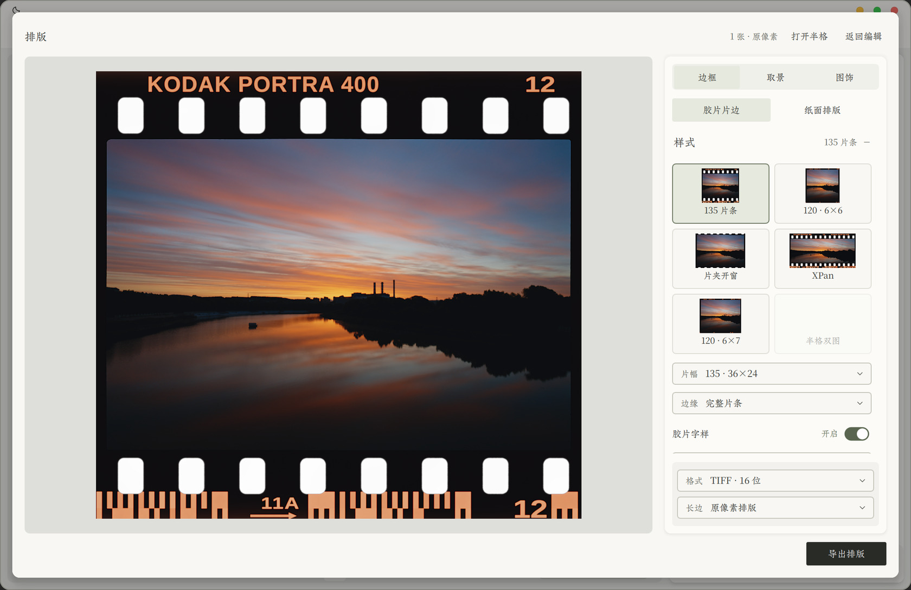
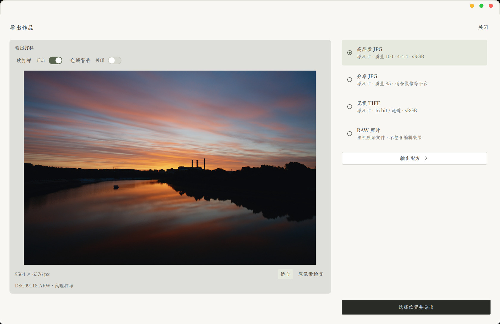

<picture>
  <source media="(prefers-color-scheme: dark)" srcset="docs/images/brand-dark.png" />
  
</picture>

SpektraFilm 是一款独立离线的 RAW 编辑与光谱胶片模拟软件。导入照片，调整光与色，按需选择胶片与相纸，再输出完整尺寸的成品。

项目基于 Andrea Volpato 的 [spektrafilm](https://github.com/andreavolpato/spektrafilm) 光谱模型与 [SpektraLab](https://github.com/JamesQiu2005/SpektraLab) 原生实现继续开发，保留材料来源、许可证与可重建代码。

[下载软件](https://github.com/Magn-bit/SpektraFilm/releases/latest) · [功能与平台](#功能与平台) · [构建指南](docs/BUILDING.md) · [反馈问题](https://github.com/Magn-bit/SpektraFilm/issues)

## 光谱显影

从输入照片的线性光数据出发，经过胶片曝光、负片／正片响应、印相或扫描，再转换到输出色彩空间。胶片、相纸、颗粒、光晕和印相参数参与成像计算；改变相纸侧参数时，可以利用缓存的负片重新印相。

- **30 款胶片、9 种相纸**：包括 Kodak VISION3 500T / 5219、Portra、反转片和黑白材料。用同一张照片探索不同胶片与印相组合。
- **显影由你决定**：导入先显示自然原片，胶片显影可以随时开启或关闭；基础修图与胶片风格可以分别控制。
- **完整光谱路径**：Windows 使用原生 C++ / Vulkan 计算核心。显式的标定快速印放选项与完整光谱区分显示，不在失败时静默替换输出模型。
- **颗粒与光学质感**：颗粒类型、强度、大小与模拟片幅，以及光晕、暗角、散射、底雾等可按需调节。

> 光谱资源包含公开资料与建模拟合，并非全部来自制造商的完整实测标定。材料来源与假设随源码保留；模拟结果也取决于输入照片、曝光、白平衡及输出显示条件。

## 光与色

基础工具围绕照片组织：曝光、白平衡、对比度、亮度、饱和度、自然饱和度和高动态范围；继续深入时，再展开色阶、曲线、HSL、原色校准与色轮。参数可精确输入，支持撤销、重做和单项复位。

  
  

**色彩与影调** · HSL 八色、原色校准、通道混合与全局／三区色轮，配合 RGB／亮度曲线、直方图与输入输出色阶。

  
  

**局部与构图** · 画笔、线性与径向渐变，每张照片独立保存蒙版和历史；直接移动裁切框，支持自由比例、XPan、旋转与几何调整。点击截图可查看完整界面。

## 单张编辑与批量出片

- **直接导入**：Windows 支持拖入照片、选择文件／文件夹和文件或图片粘贴；图库是可选路径。
- **批量处理**：多选应用胶片与编辑参数，按照片维护独立设置；批量导出保留逐张结果与失败重试。
- **更清楚地看照片**：前后对比、缩放与原像素细节查看，可收起工具区，将空间留给照片。
- **光学处理有反馈**：镜头校正显示实际匹配和应用的镜头／配置状态，未匹配时明确反馈。
- **日常风格预设**：内置 18 款人像／风光调整，默认首项为“无预设”。

## 片边与排版

排版工作区提供纸张留白、即影纸边、接触印样、多图拼接，以及胶片片边、片孔、边字和日期后背。半格双图可以共享一条显影流程，同时保留各自的取景与调整。物理片边与图形排版分别处理，导出从完整源照片重新生成。

## 完整尺寸输出

交互预览可以使用代理图；最终导出重新读取完整源像素。默认不缩小输出尺寸，只有显式裁切、尺寸配方或排版构图才改变画布。原片保持独立，RAW 另存与处理后的照片也有明确区分。

| 输出方式 | 适合什么场景 |
| --- | --- |
| 高品质 JPG | 原尺寸，质量 100 / 4:4:4，用于日常成品；JPEG 本身仍为有损格式 |
| 分享 JPG | 原尺寸，质量 85，用于微信等平台；平台可能再次压缩 |
| 无损 TIFF | 原尺寸 RGB 16 bit，适合留档与后续处理 |
| RAW 原片 | 复制相机原始文件，保留扩展名，不写入编辑效果 |
| 自定义配方 | JPEG、HEIF、PNG、TIFF、线性 DNG 等，按格式选择位深、色彩空间和命名 |
| Cineon DI | 胶片负片密度输出及配套显示 LUT，供进一步调色使用 |

导出位置可选择，文件默认命名为 `原文件名_胶片名称`，重名时自动编号。显示器 ICC、软打样与输出色彩空间可以分别设置。

## 下载与使用

| 平台 | 当前发布 | 下载与安装 |
| --- | --- | --- |
| Windows x64 | **0.8.4**，首次预览与窗口图标修订 | 下载 [分卷 001](https://github.com/Magn-bit/SpektraFilm/releases/download/v0.8.4/SpektraFilm-0.8.4-Windows-x64.7z.001) 和 [分卷 002](https://github.com/Magn-bit/SpektraFilm/releases/download/v0.8.4/SpektraFilm-0.8.4-Windows-x64.7z.002)，放在同一目录，用 7-Zip 解压 `001`，运行 `SpektraFilm.exe` |
| Android arm64-v8a | **0.5.0 / code 23** | [下载 APK](https://github.com/Magn-bit/SpektraFilm/releases/download/v0.8.4/SpektraFilm-0.5.0-arm64-v8a.apk)，在系统允许安装后打开 |
| 源码 | 当前开发源码与各发布物的对应源码 | [浏览源码](https://github.com/Magn-bit/SpektraFilm)或在 [Releases](https://github.com/Magn-bit/SpektraFilm/releases/latest) 下载对应源码包 |

Windows 便携版不需要安装 Python 或 WSL；原生 GPU 光谱路径需要可用的 Vulkan 驱动。Windows 当前未做正式代码签名，Android 包使用开发调试签名。

### 功能与平台

Windows 是当前主要开发与验收平台。Android 已有独立离线显影版本，但其发布节奏与桌面不同，**不应将这次 Windows 的全部功能视为 Android 已同步**。

| 能力 | Windows 0.8.4 | Android 0.5.0 |
| --- | --- | --- |
| 独立离线运行、RAW 导入、胶片显影 | 支持 | 支持；兼容性与速度依设备而异 |
| 原尺寸导出、基础编辑、颗粒与裁切 | 支持 | 支持；本轮未重新做真机验收 |
| 完整桌面颜色工具、图库、排版、输出配方 | 本页截图所示实现 | 不保证与桌面逐项一致 |
| 本地 CLI / stdio MCP | 支持，GUI 会话接口默认关闭 | 不提供桌面接口 |
| macOS / iOS | 暂无发布物 | 暂无发布物 |

当前为持续迭代的 0.x 版本。RAW 支持取决于解码器、相机及压缩格式；Qt 编辑画布为 SDR，HDR 增益图输出有格式和组合限制。详细边界见 [HDR 输出](docs/hdr-output.md)、[RAW 兼容记录](docs/raw-camera-compatibility.md) 与 [版本说明](docs/windows-0.8.4-verification.md)。

## 开发与参考

界面、业务状态、计算和输出分别组织，预览与成品共用编辑语义。Windows 以 Qt Quick / PySide6 构建工作区，原生 C++ / Vulkan 承担光谱计算；Android 采用 Kotlin、自定义 View / Canvas 与 NDK。LibRaw 负责相机 RAW 解码，LittleCMS 负责相关 ICC 转换与软打样。

| 路径 | 内容 |
| --- | --- |
| `desktop/` | Windows 控制器、QML 工作区、预览调度与输出 |
| `shared/` | 编辑参数、色彩与几何等共享语义 |
| `native/` | 光谱引擎、RAW／色彩／图库／元数据与编码相关源码、桥接和构建输入 |
| `android/` | Android 应用、JNI 与移动端构建配置 |
| `vendor/` | 保留来源的参考模型与材料数据 |
| `assets/`、`licenses/` | 字体、图标、资源与第三方许可 |
| `docs/`、`scripts/`、`tests/` | 开发说明、构建／发布脚本与关键节点检查 |

请从 [构建指南](docs/BUILDING.md) 开始。材料与算法来源见 [第三方说明](licenses/THIRD-PARTY.md) 和 [原生引擎记录](native/engine/UPSTREAM.json)。问题反馈建议附系统、GPU／手机型号、软件版本、输入格式与复现步骤；请勿在公开 Issue 中上传私人照片、密钥或含敏感信息的诊断文件。

## 开源与致谢

应用及原生 SpektraLab 衍生代码遵循 [GPL-3.0](LICENSE)；胶片资料、字体与第三方库分别保留其原有许可，不能将根目录许可证视为对所有资源的统一重新授权。

感谢 [Andrea Volpato / spektrafilm](https://github.com/andreavolpato/spektrafilm)、[JamesQiu2005 / SpektraLab](https://github.com/JamesQiu2005/SpektraLab)、[LibRaw](https://www.libraw.org/)、[LittleCMS](https://www.littlecms.com/) 及所使用的开源项目。本项目不包含 Lightroom 或 Capture One 的专有引擎，也不代表这些产品或胶片品牌的官方实现。

截图来自当前软件实际界面，示例为项目所有者指定的 `DSC09118.ARW`，原始 RAW 不包含在仓库或安装包中。图像使用范围与截图处理见 [图像来源](docs/images/ATTRIBUTION.md)。
